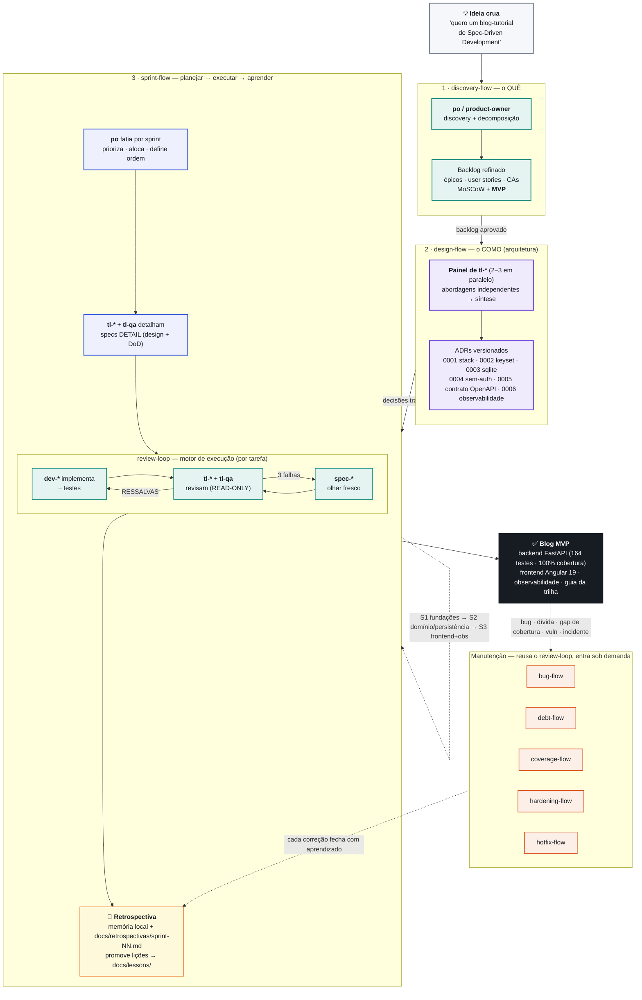

# Caminho feliz — da ideia ao blog em produção

A espinha dorsal do projeto: **`discovery-flow → design-flow → sprint-flow`** (com `review-loop` como motor e a retrospectiva fechando cada sprint). Os fluxos de manutenção só entram **depois** do MVP, quando surge um bug, dívida ou incidente.

## Como ler o diagrama

| Etapa | Skill | Produz | Papel decisor |
|-------|-------|--------|----------------|
| **1** | [`discovery-flow`](../.claude/skills/discovery-flow/SKILL.md) | Backlog refinado + MVP (`specs/features/`) | `po` decide **o quê** |
| **2** | [`design-flow`](../.claude/skills/design-flow/SKILL.md) | ADRs versionados (`specs/adr/`) — decisão **antes** do código | painel de `tl-*` decide **como** |
| **3** | [`sprint-flow`](../.claude/skills/sprint-flow/SKILL.md) | Sprints executadas + retrospectiva | `po` fatia · `tl-*` detalham · `review-loop` faz acontecer |
| motor | [`review-loop`](../.claude/skills/review-loop/SKILL.md) | Código + testes verdes, revisado | `dev-*` implementa · `tl-*`/`tl-qa` revisam |

**Regras do caminho feliz** (do [`CLAUDE.md`](../CLAUDE.md)):

- **Sequência, não pulo:** só entra em `design-flow` com backlog aprovado; só entra em `sprint-flow` com as decisões travadas em ADR; só aciona `review-loop` com o plano aprovado e os DETAIL prontos.
- **Produto antes de engenharia:** o `po` decide *o quê/quando*, o `tl-*` decide *como* — um não redefine o escopo do outro.
- **Cada sprint fecha aprendendo:** a retrospectiva grava nos dois destinos e promove o generalizável para `docs/lessons/` (ver [`loop-aprendizado.md`](loop-aprendizado.md)).
- **Manutenção é ramo, não tronco:** `bug-/debt-/coverage-/hardening-/hotfix-flow` reusam o `review-loop`, entram sob demanda depois do MVP e também fecham com aprendizado.

## O blog, concretamente (3 sprints)

- **Sprint 1** — fundações: contrato da API + esqueleto (`F001`, `F003`).
- **Sprint 2** — domínio e persistência: adapter SQLite, publish (interface/aplicação), read-by-id, 1º ratchet de cobertura backend.
- **Sprint 3** — entrega do MVP: frontend Angular 19 (codegen de tipos do OpenAPI vivo — `ADR-0005`), observabilidade (`ADR-0006`), healthcheck e o guia da trilha.

---

**Fontes:** [`specs/adr/`](../specs/adr/) · [`specs/tasks/`](../specs/tasks/) · [`docs/retrospectivas/`](retrospectivas/) · [`CLAUDE.md`](../CLAUDE.md)
