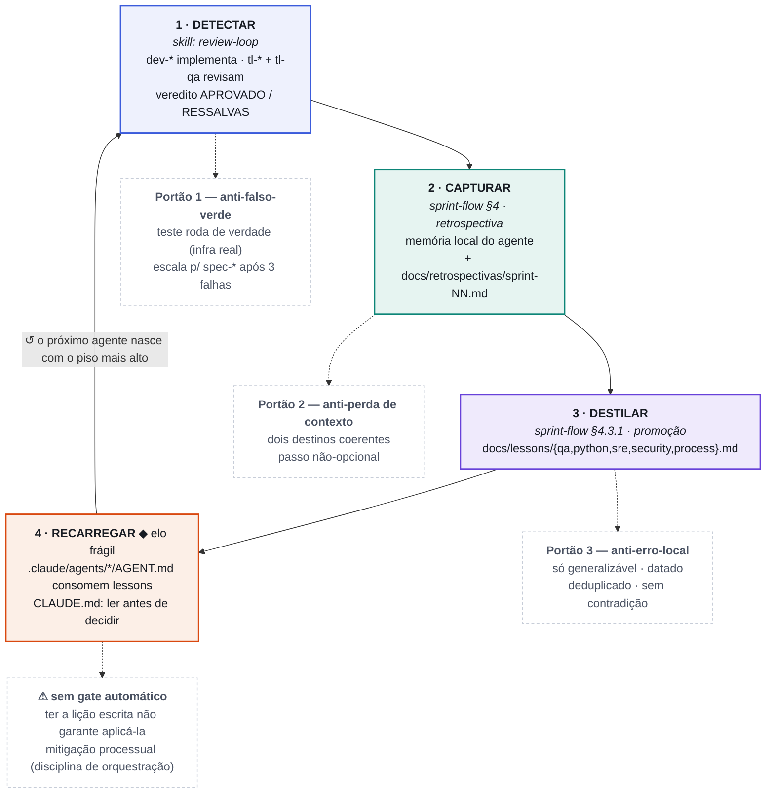

# O loop de aprendizado

Como um erro pego em **uma** implementação vira um piso de rigor que **todo** agente passa a seguir.
O ciclo tem quatro estágios (`detectar → capturar → destilar → recarregar`) e três portões anti-falso-positivo embutidos.

## Legenda dos estágios

| # | Estágio | Onde | Portão anti-falso-positivo |
|---|---------|------|-----------------------------|
| 1 | **Detectar** — o erro é pego com prova, não com relato | `.claude/skills/review-loop/SKILL.md` | Teste roda de verdade (red-green); escala para `spec-*` com contexto limpo após 3 falhas |
| 2 | **Capturar** — aprendizado persistido em dois lugares coerentes | `sprint-flow` §4 (retrospectiva) | Memória local (sobrevive à sessão) **+** doc versionado (sobrevive ao git); não-opcional |
| 3 | **Destilar** — o generalizável sobe para os playbooks | `sprint-flow` §4.3.1 | Só princípio load-bearing, datado, deduplicado, sem contradizer lição anterior |
| 4 | **Recarregar** — playbooks viram o piso de todo agente | `.claude/agents/*/AGENT.md` + `CLAUDE.md` | ⚠️ **Elo frágil**: sem gate automático — depende de ler `docs/lessons/` antes de decidir |

## O elo frágil (provado pela Sprint 3)

Captura e destilação são **estruturais** (têm gate). A vulnerabilidade real é o **recarregamento**: a lição pode existir e não ser lida no momento da decisão.

> Rodei o `tl-qa` (que muta para red-green) em paralelo com o `tl-frontend` (read-only) sobre o mesmo arquivo — anti-pattern **já documentado** em `process.md`. A lição já existia; o custo foi não tê-la aplicado.
> — [`docs/retrospectivas/sprint-03.md`](retrospectivas/sprint-03.md)

No mesmo episódio o mecanismo também funcionou: a retrospectiva **reforçou** a lição existente em vez de duplicá-la — exatamente a regra de deduplicação do Portão 3.

---

**Fontes:** [`review-loop`](../.claude/skills/review-loop/SKILL.md) · [`sprint-flow`](../.claude/skills/sprint-flow/SKILL.md) · [`docs/lessons/README.md`](lessons/README.md) · [`docs/retrospectivas/sprint-03.md`](retrospectivas/sprint-03.md)
